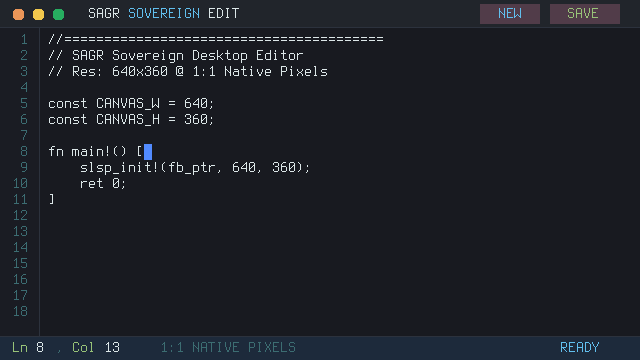

# SAGR Simple Display & Window Manager

> [!WARNING]
> **Notice**: The desktop editor is an **experimental prototype** provided for demonstration only, with **no stability, production, or backwards-compatibility guarantees**.

A proof-of-concept demonstrating that **SAGR** (*Simple Analytical Grid Renderer*) operates completely outside the terminal, driving a native Linux desktop window via direct 1:1 framebuffer blitting (`XPutImage`).



---

## 1. Architectural Highlights

- **100% SAGR Rendered Pixels**:
  - Every single pixel displayed on the screen is generated by SAGR (`sagr/` and `editor.sinc`).
  - **Zero GUI Widget Libraries**: No Qt, no GTK, no Tkinter widgets.
  - The desktop window is a pure raster canvas displaying SAGR's internal RGBA8 pixel buffer at native 1:1 scale.
- **Direct X11 Framebuffer Blitter (`x11_connector.c`)**:
  - Connects to the active X11 display.
  - Uses standard `XPutImage` to blit the unscaled $640 \times 360$ SAGR framebuffer directly onto the desktop window.
  - Captures raw X11 mouse clicks `(x, y)` and keyboard strokes, forwarding them into the SAGR engine.
- **Math & Memory Guarantees**:
  - **Zero Floats**: 100% integer math.
  - **Zero Dynamic Allocations**: Static linear bump arena (`steel/sys/arena.sinc`).
  - **Zero OS Graphics API Dependency**: The core engine knows nothing about X11 or Wayland; it only writes pixels to raw memory.

---

## 2. Window Layout & Interactive Hit Testing

SAGR renders an authentic $640 \times 360$ raster buffer displayed at **1:1 native pixel resolution** using the Terminus $8 \times 16$ bitmap font:

```
+------------------------------------------------------------------------------+
| 🔴 🟡 🟢   SAGR SIMPLE EDIT                              [NEW]  [SAVE]       | <- Title Bar (y=0..27)
+----+-------------------------------------------------------------------------+
|  1 | //========================================                              | <- Editor Canvas
|  2 | // SAGR Simple Desktop Editor                                           |    (x=44..636, y=28..335)
|  3 | // Res: 640x360 @ 1:1 Native Pixels                                     |
|  4 |                                                                         |
|  5 | const CANVAS_W = 640;                                                   |
|  6 | const CANVAS_H = 360;                                                   |
|  7 |                                                                         |
|  8 | fn main!() [                                                            |
|  9 |     slsp_init!(fb_ptr, 640, 360);                                       |
| 10 |     ret 0;                                                              |
| 11 | ]                                                                       |
+----+-------------------------------------------------------------------------+
| Ln 8, Col 13     1:1 NATIVE PIXELS | 0 ALLOC                            READY| <- Status Bar (y=336..359)
+------------------------------------------------------------------------------+
  ^
  Gutter (x=0..39)
```

### Interactive Hit-Testing
- **Click 🔴 (Close Button, $x \in [10..26], y < 28$)**: Exits the application and destroys the window.
- **Click 🟡 (Minimise Button, $x \in [30..46], y < 28$)**: Minimises the window via X11 iconification.
- **Click 🟢 (Maximise Button, $x \in [50..66], y < 28$)**: Window management toggle.
- **Click `[NEW]` ($x \in [480..540], y < 28$)**: Clears the text buffer and re-renders an empty canvas.
- **Click `[SAVE]` ($x \in [550..620], y < 28$)**: Writes the document to `scratch/editor_saved.txt` and flashes `[SAVED TO DISK]` in emerald green.
- **Click Text Area ($x \ge 48, y \in [32..320]$)**: Sets the active cursor position to the clicked row and column.
- **Keyboard Input**: Type any alphanumeric or symbol key to insert text, Backspace to delete, or Arrow keys to navigate.

---

## 3. System Requirements & Running

### Dependencies for Live Desktop Mode
To run the live interactive desktop window (`play.sh`), your system requires:
1. **X11 Development Headers**:
   - Debian / Ubuntu: `sudo apt install libx11-dev`
   - Fedora / RHEL: `sudo dnf install libX11-devel`
   - Arch Linux: `sudo pacman -S libx11`
2. **An Active Display Server**: A running X11 or Xwayland server reachable via the `$DISPLAY` environment variable (e.g. `DISPLAY=:0` or `DISPLAY=:1`).

### Running the Example

#### 1. Live Interactive Desktop Window
```bash
./examples/editor/play.sh
```
*Compiles the SAGR SINC engine and pure X11 connector, then opens a native $640 \times 360$ desktop window.*

#### 2. Headless Automated Verification (CI / Servers without DISPLAY)
```bash
./examples/editor/run.sh
```
*Requires zero GUI dependencies. Compiles the engine, renders a bit-perfect $640 \times 360$ Netpbm PPM frame, tests disk saving, and confirms exit code 0.*

#### 3. Native Terminal Text Console (Optional)
```bash
./examples/editor/play.sh --terminal
```
*Runs the SINC bytecode engine inside any standard terminal text console without requiring X11.*
